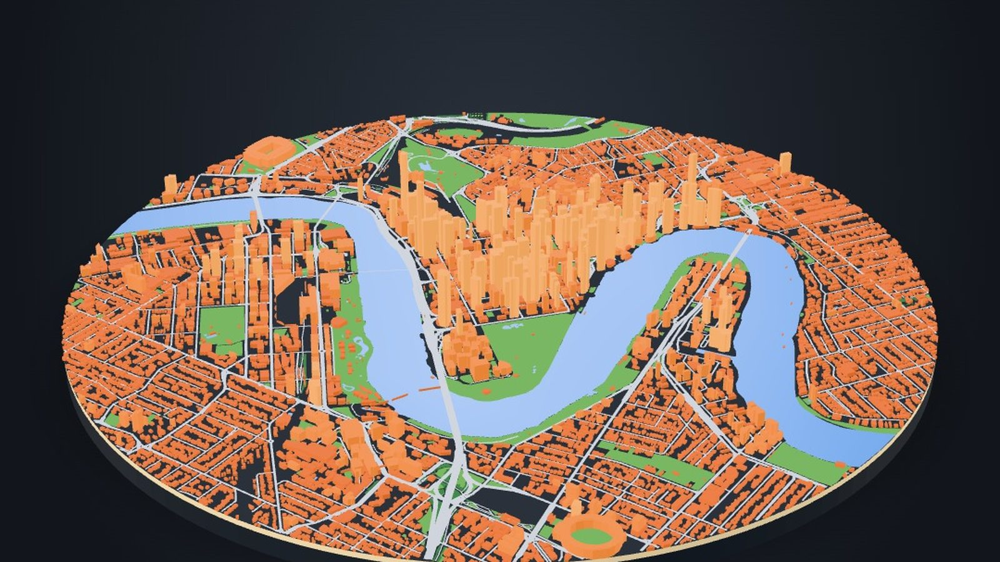

# Brisbane on a table

Central Brisbane as a round model 60 cm across, to stand on a real table in AR from a phone. 4 km of the river looping round the city, South Bank, Kangaroo Point and New Farm. **Live version, with the model to turn and the AR button:** [getplotlay.com/showcase/brisbane-on-a-table](https://www.getplotlay.com/showcase/brisbane-on-a-table/)



**7,886 buildings on 60 cm of table, at 1:6,670.** The tallest is 270 m. Every building over 100 m has a height mapped in OpenStreetMap. The model is 113,353 triangles, inside a 120,000 cap set for a phone's AR.

The model was made with Plotlay's Tabletop city, from Plotlay's own OpenStreetMap vector tiles. The pictures and the animation are frames from the app's Tabletop city viewer.

[](https://app.plotlay.io/?tabletop=-27.47200,153.02700,2000,warm,1.5,60&name=Brisbane%20on%20a%20table)

## Read this first

- **Two thirds of the heights are estimates.** OpenStreetMap has a height or a number of levels for 2,712 of the 7,886 buildings. The other 5,174 (66%) take a height from their kind and the size of their outline. Every estimate is 14 m or lower, so the skyline is mapped and the estimates are houses, sheds and low blocks.
- **Heights are drawn 1.5 times true scale.** At true scale a house would stand about 1 mm high on the table. Footprints, the river and the roads are true to scale.
- **Flat tops.** Each building, or building part, is one block at one height.
- **Left out:** 505 buildings smaller than 0.8 mm² on the table, roads thinner than 0.75 mm on the table, paths, railways and tunnels.
- OpenStreetMap as served by the tiles on 26 November 2026.

## Put it on a table

| Phone | How |
|---|---|
| iPhone or iPad | Open the showcase page in Safari, tap **View on a table in AR**. AR Quick Look opens `model/warm.usdz`. |
| Android with Google Play Services for AR | Open the showcase page in Chrome, tap **View on a table in AR** (WebXR or Scene Viewer, with `model/warm.glb`). |
| Anything else | Download the GLB or USDZ and open it in a 3D app (Blender, Reality Composer, Windows 3D Viewer). |

## What's here

| Path | What |
|---|---|
| `model/warm.glb`, `sepia.glb`, `ink.glb` | The model in each of Plotlay's three tabletop looks, glTF 2.0 binary (about 6 MB each) |
| `model/*.usdz` | The same for AR Quick Look (about 12 MB each) |
| `data/buildings.csv` | The 7,886 buildings on the model, tallest first: where each one's middle is, its height, where the height comes from (mapped, or estimated by size or kind), its footprint and kind. Loads in Power BI (a map visual on latitude and longitude), Python or a spreadsheet |
| `data/numbers.json` | The settings and every number on the page and in this README |
| `method/check_model.py` | Reads a GLB with the Python standard library and prints its meshes, triangles, size on the table and the credit inside it |
| `visuals/` | The pictures and the animation from the app |

```
python3 method/check_model.py model/warm.glb
```

## How it was made

1. In Plotlay, **Tabletop city** from the search.
2. Centre -27.4720, 153.0270 (on the river beside the city centre), a circle of 2,000 m radius, the Warm look, heights 1.5 times, 60 cm on the table.
3. Plotlay reads the 18 map tiles at zoom 15 that cover the circle, cuts every building outline, park, wood, water body and road at the circle, and sets them on an 18 mm slab with a 4 mm band.
4. To keep it light for a phone, buildings are merged into one mesh per map tile and height band, outlines are simplified to 0.3 mm on the table, small houses become their rectangle, and a 120,000 triangle cap leaves out the smallest buildings first (none needed here).
5. GLB and USDZ are written in the browser, with "© OpenStreetMap contributors" and the ODbL note inside each file.

The link above rebuilds the same model from the public tiles on any device.

## Sources and licences

- Buildings, heights, levels, water, parks, woods and roads: © OpenStreetMap contributors, [Open Database Licence](https://www.openstreetmap.org/copyright), through Plotlay's vector tiles built by Protomaps.
- See `NOTICE` for what each part of this repository is licensed under.

This is independent work using open data, not endorsed by Brisbane City Council or the Queensland Government.
